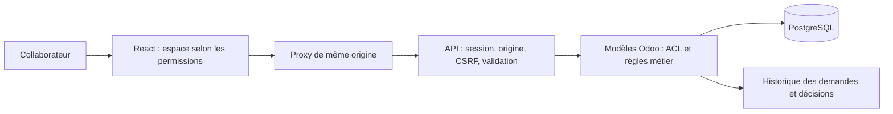
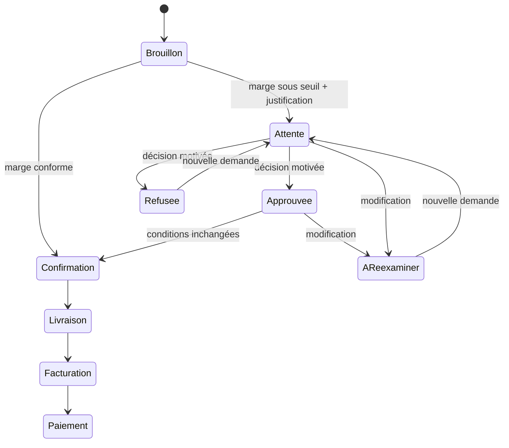

# Architecture d’Optika Operations

## Parcours connecté

Odoo reste responsable des coûts, taxes, devis, stocks, écritures comptables et paiements. Le navigateur n’accorde aucune permission serveur. Le groupe opérations réunit les permissions métier nécessaires au cockpit global ; un simple commercial ne reçoit pas ces permissions.

La logique du circuit d’approbation est partagée par l’API et les assistants Odoo. Les méthodes internes sont privées ; les méthodes RPC publiques recontrôlent les ACL. Une empreinte des conditions lie chaque demande au contenu examiné. L’ajout, la modification ou la suppression d’une ligne annule une demande active ; une vérification supplémentaire protège la confirmation contre les changements de seuil ou les anciens accords.

## Cycle d’un devis

L’état d’approbation et l’état du devis sont distincts. Une dérogation approuvée peut encore correspondre à un devis non confirmé. Un changement de seuil bloque la réutilisation de l’empreinte précédente ; modifier puis resoumettre le devis ouvre une nouvelle demande.

## Mode de démonstration

Le mode local utilise un adaptateur distinct et n’authentifie aucun compte Odoo. Les données fictives sont persistées sous `optika-operations-demo-v1` dans le stockage du navigateur. La déconnexion permet de changer de rôle, la réinitialisation restaure le jeu initial. Ne jamais y introduire des données confidentielles.

Cet adaptateur reproduit les transitions nécessaires à la présentation et possède ses propres contrôles de rôle. Il ne constitue pas une barrière de sécurité : le visiteur maîtrise son navigateur. Les tests de cet adaptateur ne prouvent pas le fonctionnement des modules Odoo ; les tests serveur sont séparés.

## Indicateurs

- **Facturé HT** : factures clients comptabilisées de la société active, en devise société. Les avoirs ne sont pas inclus ; il ne s’agit donc pas d’un chiffre d’affaires net d’avoirs.
- **Montant réglé sur factures** : total TTC des factures moins leur solde. Un rapprochement, une compensation ou un avoir peut solder une facture ; cet indicateur n’est pas un relevé des mouvements bancaires.
- **Reste à recevoir** : solde TTC des factures clients comptabilisées.
- **Retard** : solde TTC dont l’échéance est antérieure à la date serveur.
- **Balance âgée** : non échues, 1–30, 31–60 et plus de 60 jours.

Les listes ont une pagination serveur. Les colonnes logistiques et CRM comptent les éléments de la page courante. Le graphique charge un module séparé pour limiter le JavaScript initial.

## Limites explicites

- La simulation du devis utilise les prix catalogue et coûts disponibles ; le calcul final appartient à Odoo.
- La création et la modification des devis en devise étrangère passent par Odoo ; le formulaire simplifié utilise la devise société.
- La saisie des lots et numéros de série doit être effectuée dans Odoo. L’API refuse de valider ces produits dans son formulaire simplifié.
- La démonstration locale n’applique pas de taxes, ne réserve pas physiquement le stock et ne réalise aucun paiement bancaire. La facturation locale se limite aux quantités livrées non encore facturées.
- Les formulaires client, fournisseur et produit chargent au maximum 200 options ; la recherche client et produit du devis est effectuée côté serveur. Pour des catalogues plus grands, étendre les autres sélecteurs avec la même recherche distante.
- Le pipeline regroupe les probabilités en quatre colonnes sans remplacer les étapes configurées dans Odoo.
- Le journal, les méthodes et les comptes des paiements doivent être configurés dans Odoo.
- La CI Odoo est définie mais doit être exécutée dans un environnement Docker disponible avant livraison réelle. Un build frontend réussi ne valide pas une installation Odoo.
- Pour une exposition publique : proxy HTTPS, sauvegardes vérifiées, supervision et configuration des accès sont à prévoir. Le Compose fourni publie Odoo sur la boucle locale.

## Références de conception

Les comportements de session, CSRF et validation des mouvements ont été vérifiés dans les sources officielles Odoo 17 : [couche HTTP](https://github.com/odoo/odoo/blob/17.0/odoo/http.py), [session web](https://github.com/odoo/odoo/blob/17.0/addons/web/controllers/session.py) et [mouvements de stock](https://github.com/odoo/odoo/blob/17.0/addons/stock/models/stock_picking.py).
